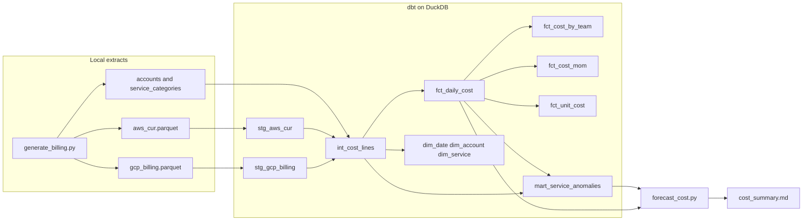

# Cloud cost analytics with dbt and DuckDB

Personal portfolio project for cloud cost (FinOps) data engineering. It generates a labelled synthetic billing extract, models it in [dbt](https://docs.getdbt.com/) on [DuckDB](https://duckdb.org/), tests the model, screens daily cost for spikes, and writes a local forecast and a markdown/HTML summary.

Nothing here is a production cost platform. There is no cloud account, no bill, and no claim that the detector or the forecast would hold up on real spend. The numbers in this README are computed from the synthetic extract (`seed = 42`, 2026-04-01 through 2026-09-30). Re-running `make report` reproduces them.

## Problem

Finance and platform teams usually get cost from two incompatible extracts:

- AWS Cost and Usage Report (CUR): one row per line item. Usage cost is positive. Credits are separate rows with a negative unblended cost. Account names are not on the line.
- GCP Cloud Billing export: one row per SKU per day in this dataset, with `cost` positive and `credits_amount` negative, and labels already on the row. A real detailed export is nested; this project uses a flattened stand-in.

The useful questions sit one layer above either extract: what did each team spend, how did a service move month over month, what is the unit cost, and which days are far enough from the recent run-rate to look at. This repo is a local, free way to practice that modeling, the tests around it, and the CI that keeps it honest.

## What you get

| Piece | Role |
| --- | --- |
| `scripts/generate_billing.py` | Deterministic synthetic AWS CUR and GCP billing Parquet, plus the account and service-category seeds |
| dbt project `finops_cost` | Staging views, one conformed intermediate model, dimensions, and cost marts |
| Singular and generic dbt tests | Grain, signs, reconciliation, and the anomaly screen |
| `mart_service_anomalies` | Rolling 28-day z-score per account and service, with a lift guard |
| `scripts/forecast_cost.py` | OLS trend plus a weekday residual, with a 28-day holdout MAPE on this series |
| `scripts/render_report.py` | `reports/cost_summary.md` and `reports/cost_summary.html` |
| GitHub Actions | `make ci` on Ubuntu with Python 3.12. No secrets |

## Architecture



DuckDB reads the Parquet files through dbt source `external_location` values. The warehouse file is `data/warehouse/finops.duckdb`. `profiles.yml` is checked in because it only points at that local file.

Staging models are views. Marts are tables. Schemas are `staging`, `intermediate`, `marts`, and `seed`, via `macros/generate_schema_name.sql`.

## Synthetic dataset

`scripts/catalog.py` is the source of the workloads. `scripts/generate_billing.py` expands them to one row per resource per day. AWS credits are extra line items. The generator is deterministic (`numpy` Generator, seed 42).

| | |
| --- | --- |
| Window | 2026-04-01 through 2026-09-30 |
| AWS accounts | `aws-prod-platform`, `aws-prod-data`, `aws-staging`, `aws-sandbox` (fake 12-digit ids) |
| GCP projects | `gcp-prod-analytics`, `gcp-prod-app`, `gcp-staging`, `gcp-sandbox` |
| Teams | `data-platform`, `product-backend`, `shared-services`, `ml-platform`, `finops` |
| Grain | Daily. A real CUR is often hourly. Invoice lag is not modelled. |
| Label | Every row has `_dataset_label = synthetic-finops-portfolio` and `_synthetic = true` |
| Prices | Rounded public list-price anchors so the shape is recognisable. Not a current quote. |

Injected incidents, each stored as `_spike_id` on the affected lines:

| id | what it simulates |
| --- | --- |
| `syn-sandbox-ec2` | Sandbox EC2 left scaled up for one day (2026-05-12) |
| `syn-ec2-autoscale` | Prod EC2 did not scale in (2026-06-09 through 2026-06-11) |
| `syn-bq-full-scan` | BigQuery analysis job scanned an unpartitioned table (2026-07-21) |
| `syn-nat-cross-az` | Cross-AZ traffic hairpinned through a NAT gateway (2026-08-18 and 2026-08-19) |

Storage workloads use a monthly accrual (usage divided by the number of days in the month). That matters for the anomaly screen below: a 31-day month and a 30-day month are not the same daily rate even when the month is smooth.

On this seed the generator writes 7,869 AWS rows and 5,124 GCP rows. Totals are in [Sample output](#sample-output). `data/raw/generation_manifest.json` records the catalog, the spike list, and the extract totals. Parquet files and the DuckDB file are gitignored; `make generate` rewrites them.

## Cost signs

The conformed model uses one convention, because the two extracts do not.

| Column on `int_cost_lines` | Meaning |
| --- | --- |
| `gross_cost` | Usage cost. Zero on an AWS credit line. Always >= 0. |
| `credit_amount` | Credit as a positive magnitude. AWS credit lines negate the negative CUR amount. GCP uses `-credits_amount`. |
| `net_cost` | `gross_cost - credit_amount`. |

An individual AWS credit line therefore has a negative `net_cost`. After aggregation, `fct_daily_cost.net_cost` is tested to be >= 0. Do not sum `line_item_unblended_cost` and also subtract credits; the credit is already inside the CUR amount.

## Models

Documented column by column under `models/` and `seeds/_seeds.yml`.

### Staging

| Model | Grain | Notes |
| --- | --- | --- |
| `stg_aws_cur` | One synthetic CUR line | Casts, and renames the generator's `_synthetic` / `_dataset_label` / `_spike_id` |
| `stg_gcp_billing` | One flattened billing row | Same label columns. Credits stay negative here, matching the export |

### Intermediate

`int_cost_lines` is the multi-cloud contract. AWS usage accounts are named from the `accounts` seed. GCP project names already exist on the extract and are kept. Both sides share `cloud_provider`, `account_id`, `usage_date`, `service_name`, `usage_type`, tags (`team`, `environment`, `cost_center`, `application`), and the cost columns above.

### Marts

| Model | Grain | What it answers |
| --- | --- | --- |
| `dim_date` | One calendar day from the first usage date through the last | Continuous spine. A gap fails `assert_dim_date_has_no_gaps` |
| `dim_account` | Account or project | Name, billing account, environment, first and last usage date |
| `dim_service` | Service | `service_category` from the `service_categories` seed. A service missing from the seed is dropped here and fails `assert_services_have_categories` |
| `fct_daily_cost` | Day, account, service, usage type, unit, region, team, environment, cost center, application | The fact everything else aggregates. `daily_cost_key` is an `md5` of that grain |
| `fct_cost_by_team` | Month, team, environment, cost center, cloud | Net cost and `share_of_month` across the whole month |
| `fct_cost_mom` | Month, account, service | `prev_month_net_cost`, absolute change, percent change. The first month of a series is null, not zero |
| `fct_unit_cost` | Day, account, service, usage type, region | `gross_unit_cost` and `net_unit_cost`. Credits pull the net rate below the anchor rate |
| `mart_service_anomalies` | Day, account, service | Rolling baseline, z-score, `is_cost_spike`, and `labelled_spike_id` when a line that day was multiplied |

`analyses/spike_review.sql` is the short list of flagged days. It is not built by `dbt build`; compile or run it when you want the query.

## Tests

`dbt build` runs models and tests together. The last local run was 253 passing results, 0 warnings, 0 errors. That count includes model builds and seed loads, not only assertions.

Generic tests live on the YAML contracts: `unique`, `not_null`, `accepted_values`, `relationships`, and `unique_combination_of_columns`. Two project tests are macros in `macros/generic_tests.sql`:

- `not_negative` — the column is >= 0. Applied to gross cost, credit magnitude, and aggregated net cost. Not applied to `int_cost_lines.net_cost`, because a credit line is negative there on purpose.
- `unique_combination_of_columns` — the grain columns are unique.

Singular tests in `tests/`:

| Test | Fails when |
| --- | --- |
| `assert_only_synthetic_rows` | A row is missing the dataset label or the synthetic flag |
| `assert_aws_usage_cost_non_negative` | An AWS Usage line has a negative unblended cost |
| `assert_aws_credits_are_negative` | An AWS Credit line is not strictly negative |
| `assert_gcp_cost_and_credit_signs` | GCP `cost` is negative, or a credit amount is positive |
| `assert_no_negative_cost` | Aggregated gross, credit, or net cost is negative |
| `assert_net_cost_reconciles` | `net_cost` is not `gross_cost - credit_amount` |
| `assert_no_rows_dropped_at_conform` | Staging row counts do not match `int_cost_lines` |
| `assert_account_attributes_match_seed` | An account name or environment disagrees with the seed |
| `assert_services_have_categories` | A billed service has no category seed |
| `assert_dim_date_has_no_gaps` | The date spine skips a day |
| `assert_team_shares_sum_to_one` | Team shares for a month do not sum to 1 |
| `assert_mom_matches_prior_month` | The lagged month does not equal that month's own net cost |
| `assert_anomaly_flags_respect_threshold` | A flagged day misses the history, z-score, or lift rule |
| `assert_labelled_spikes_are_flagged` | An injected spike day is not flagged |

Python tests in `tests/test_generate_billing.py` and `tests/test_forecast.py` cover the generator's invariants and the forecast fit. They do not need a warehouse.

## Anomaly screen

`mart_service_anomalies` scores daily net cost by `cloud_provider`, `account_id`, and `service_name`. For each day it looks at the previous 28 days, excluding the current day:

- `history_days` — how many of those days exist
- `rolling_mean_cost`, `rolling_stddev_cost` — sample mean and sample standard deviation
- `z_score` — `(net_cost - mean) / stddev`, and only when `history_days >= 14`

`is_cost_spike` is true when all three hold:

1. at least 14 prior days,
2. `z_score >= 3`,
3. net cost is at least 25% above the trailing mean (`anomaly_min_lift_ratio`).

The lift rule is there because a bare z-score flags smooth storage. Daily storage accrual depends on the length of the month, so the first of a 30-day month can sit a few standard deviations above a window full of 31-day rates without being an incident. The thresholds are dbt vars in `dbt_project.yml`.

On this generated dataset the screen flags 7 account-service-days. All 7 carry an injected spike id. None of the flagged days are unlabelled. That is a check that the multipliers are visible to this screen, not a measure of precision on real billing data. A quiet series with a one-day blip is an easy target. Real cost data has reservations, delayed credits, and shared-cost allocation that this model does not represent.

## Forecast

`scripts/forecast_cost.py` reads `fct_daily_cost` and `mart_service_anomalies` from the warehouse. For total, AWS, and GCP net cost it fits:

- an ordinary least-squares line of net cost on a day index
- an additive residual for each weekday, estimated on the training days

Days with `is_cost_spike` are left out of the fit. The script then holds out the last 28 days, refits on the earlier days, and reports MAPE. The published band is +/- 1.96 residual standard deviations. It is a picture of recent residual scatter, not a calibrated prediction interval. MAPE below is a backtest on this synthetic series only.

| series | holdout MAPE | slope per day (USD) |
| --- | --- | --- |
| total | 2.2% | 0.44 |
| aws | 1.8% | 0.27 |
| gcp | 2.2% | 0.17 |

The holdout window on this seed does not contain a flagged spike, so MAPE excluding spike days matches the headline MAPE. A low error is expected: the generator is a smooth trend, weekday factors, small noise, and a handful of labelled spikes that the fit is allowed to ignore.

## How to run

Python 3.12, matching CI. From the repository root:

```bash
python3 -m venv .venv
source .venv/bin/activate
make setup
make ci
```

`make ci` lints with ruff and sqlfluff, runs pytest, generates the extracts, runs `dbt build --target ci`, then writes the forecast and the report.

Step by step:

```bash
make generate   # data/raw/*.parquet, seeds, generation_manifest.json
make build      # generate, then dbt build --target dev
make test       # pytest only
make lint       # ruff and sqlfluff
make forecast   # data/forecast/
make report     # forecast plus reports/cost_summary.md and .html
make clean      # drop target/, logs/, the warehouse, and the parquet extracts
```

`DBT_PROFILES_DIR` is set to the repository root by the Makefile. If you call `dbt` yourself, export it the same way.

Pre-commit runs the same ruff and sqlfluff hooks:

```bash
pre-commit install
pre-commit run --all-files
```

## Sample output

From `reports/cost_summary.md` after `make ci` on seed 42. Synthetic.

Window 2026-04-01 through 2026-09-30. Gross cost $139,327.98. Credits $5,690.90. Net cost $133,637.08.

| cloud | net cost | gross cost |
| --- | --- | --- |
| aws | $86,268.94 | $90,065.50 |
| gcp | $47,368.14 | $49,262.48 |

September 2026 net cost by team:

| team | net cost |
| --- | --- |
| data-platform | $13,344.67 |
| product-backend | $6,373.48 |
| shared-services | $2,554.88 |
| ml-platform | $577.21 |
| finops | $103.17 |

Flagged days, highest z-score first:

| date | account | service | net cost | baseline | z | spike |
| --- | --- | --- | --- | --- | --- | --- |
| 2026-05-12 | aws-sandbox | Amazon Elastic Compute Cloud | $32.67 | $1.97 | 57.80 | syn-sandbox-ec2 |
| 2026-08-18 | aws-prod-platform | Amazon Virtual Private Cloud | $120.72 | $20.21 | 42.89 | syn-nat-cross-az |
| 2026-06-09 | aws-prod-platform | Amazon Elastic Compute Cloud | $478.07 | $117.41 | 31.16 | syn-ec2-autoscale |
| 2026-07-21 | gcp-prod-analytics | BigQuery | $492.19 | $78.16 | 23.53 | syn-bq-full-scan |
| 2026-06-10 | aws-prod-platform | Amazon Elastic Compute Cloud | $455.67 | $130.01 | 4.71 | syn-ec2-autoscale |
| 2026-08-19 | aws-prod-platform | Amazon Virtual Private Cloud | $112.54 | $23.69 | 4.64 | syn-nat-cross-az |
| 2026-06-11 | aws-prod-platform | Amazon Elastic Compute Cloud | $457.62 | $141.98 | 3.41 | syn-ec2-autoscale |

The full summary, including unit cost and the next seven forecast days, is `reports/cost_summary.md`.

## CI

`.github/workflows/ci.yml` runs on pushes to `main` and on pull requests. The job checks out the repo, installs `requirements.txt` on Python 3.12, and runs `make ci`. No credentials are used.

## Possible extensions

These are not built. They are the seams I would use if this stopped being a local exercise.

- **Real AWS CUR.** Deliver CUR as Parquet to S3 and query it with Athena, or download a manifest's files and point `models/sources.yml` at that path. Staging would have to grow the columns this extract skips: line item type values other than Usage and Credit, reservation and Savings Plan columns, split cost allocation, and usually an hourly grain. Amortized cost and unblended cost answer different questions; this project only has the unblended-style amount.
- **Real GCP billing export.** The detailed usage export in BigQuery stores `credits`, `labels`, `project`, and `service` as nested records. Staging would `UNNEST` credits instead of reading a pre-flattened `credits_amount`. Invoice month and usage date diverge once export delay exists; this generator sets them to the same month.
- **FOCUS.** A second conformed model on the FinOps [FOCUS](https://focus.finops.org/) columns would sit beside `int_cost_lines` and make a later warehouse swap less painful.
- **A warehouse that is not a file.** `profiles.yml` is the only place the DuckDB path is set. Swapping the target for Postgres, BigQuery, or Snowflake means revisiting `generate_series` and the Parquet `external_location`, which are DuckDB-specific, and the sqlfluff dialect.

## Layout

```text
models/staging          stg_aws_cur, stg_gcp_billing
models/intermediate     int_cost_lines
models/marts            dimensions, facts, mart_service_anomalies
tests                   singular dbt tests and pytest
macros                  schema name, surrogate key, generic tests
seeds                   accounts, service_categories
scripts                 catalog, generator, forecast, report
analyses                spike_review.sql
reports                 generated summary
.github/workflows       CI
```
